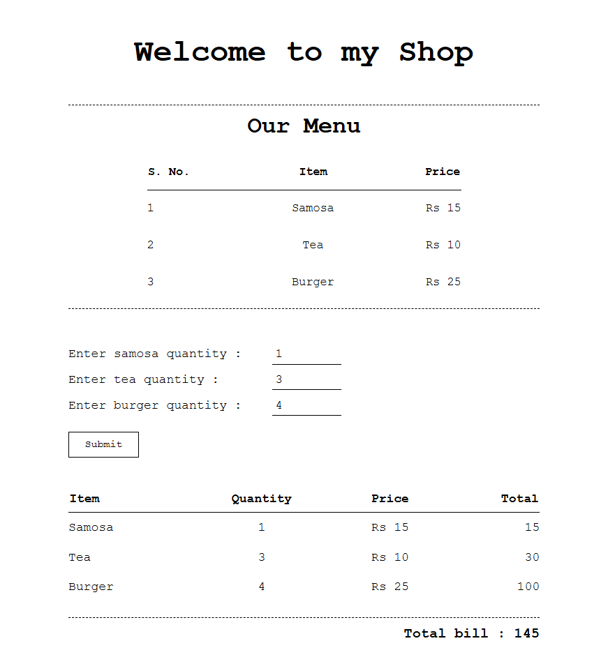
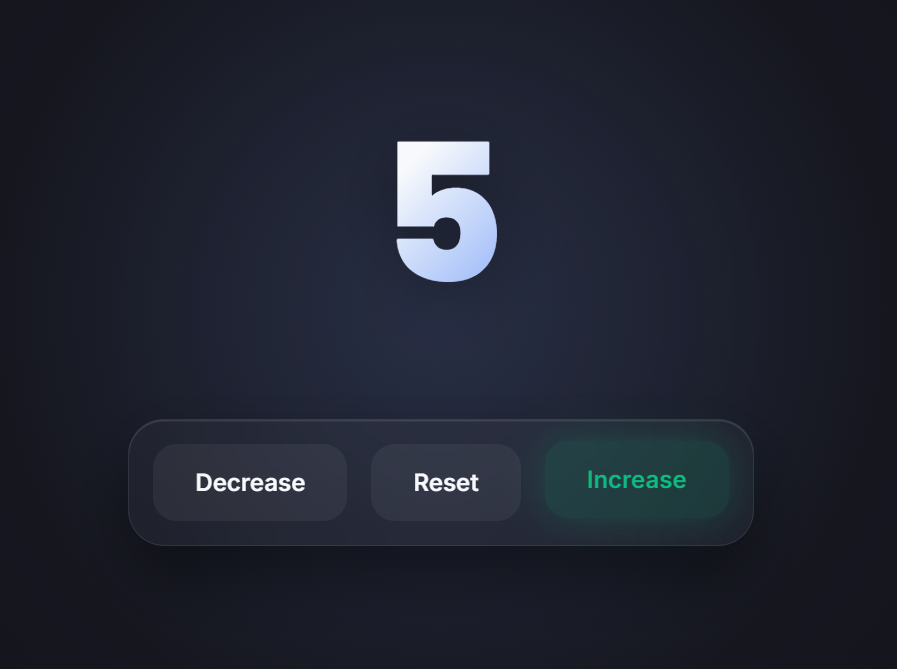

# Anonymous — JavaScript Mini Projects

A collection of small web development projects built while learning HTML, CSS, and JavaScript. Each project focuses on basic programming concepts and interactive webpage functionality.

## Projects

### 1. Bill
A shop billing application that calculates item-wise costs and the final bill based on customer-entered quantities.

### 2. Counter
A simple interactive counter that lets users increase, decrease, and reset a displayed number.

## Tech Stack

- HTML5
- CSS3
- JavaScript